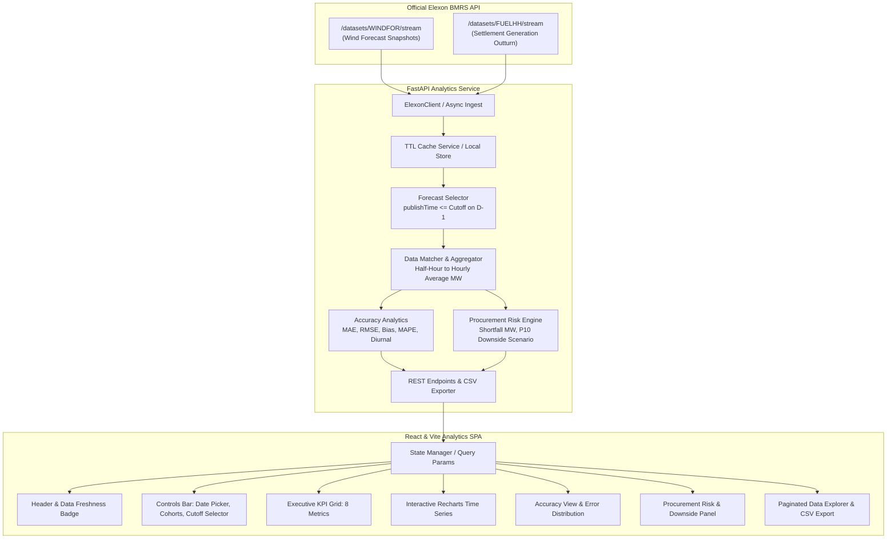

# UK Wind Power Forecast & Day-Ahead Procurement Analytics Dashboard

> **Production-Grade Energy Market Analytics Terminal for UK Electricity Procurement Desks**  
> Ingests official Elexon BMRS generation datasets (`FUELHH` and `WINDFOR`), strictly enforces day-ahead gate closure cutoffs to prevent look-ahead bias, evaluates forecast error accuracy, and transparently quantifies potential wind generation shortfall risks.

---

## 1. Executive Summary & Business Problem

In the Great Britain (GB) wholesale electricity market, retail utility procurement desks and balance responsible parties (BRPs) must purchase sufficient wholesale power one day prior to delivery ($D-1$) to balance anticipated consumer electricity demand against generation supply. 

Wind power represents a substantial and growing component of Great Britain's energy mix (exceeding 28 GW of installed capacity). However, wind output is weather-dependent and volatile. Under Great Britain's Balancing and Settlement Code (BSC), physical volume imbalances between contracted position and metered outturn are settled at the **System Buy Price (SBP)** or **System Sell Price (SSP)** in cashout settlement, which can expose utilities to severe financial penalties during high-demand or low-wind periods.

This application provides the utility's day-ahead electricity procurement team with an institutional-grade analytics terminal to:
1. **Identify the exact wind forecast snapshot available at gate closure**: Specifically selecting the latest forecast published on or before the day-ahead procurement decision cutoff (e.g., 11:00 AM UK time on $D-1$).
2. **Eliminate look-ahead bias**: Guaranteeing that forecasts published *after* auction gate closure are never back-fitted into historical accuracy evaluations.
3. **Benchmark forecast accuracy against settlement actuals**: Computing quantitative metrics (MAE, RMSE, Mean Bias, and conditional MAPE) across January 2026 delivery cohorts.
4. **Quantify uncontracted wind shortfall volume**: Estimating physical volume deficit risks ($\max(0, \text{Forecast} - \text{Actual})$) and conservative downside risk scenarios (P10) to guide hedging buffers in intraday and day-ahead auctions.

---

## 2. Key Features

- **Decision Cutoff Enforcement**: Strict filtering of National Grid ESO `WINDFOR` forecast snapshots to select the latest snapshot published prior to the configured market cutoff ($D-1$ at 11:00 UK time by default), entirely preventing look-ahead bias.
- **Configurable Auction Cutoffs**: Justified presets representing real UK market gate closures:
  - `11:00 UK Time`: Primary EPEX SPOT GB & Nord Pool GB Day-Ahead auction gate closure (Default).
  - `12:00 UK Time`: Post-auction clearing & secondary procurement window.
  - `15:30 UK Time`: EPEX GB 15:30 day-ahead reference auction gate closure.
  - `17:00 UK Time`: Trading desk end-of-shift close.
  - `23:00 UK Time`: Pre-midnight final day-ahead position lock.
- **Delivery vs Decision Cohort Filtering**: Support for evaluating by **Delivery Date** (physical power delivered) or **Decision Date** (commercial cohort decided on $D-1$, properly capturing January 31 decisions that deliver on February 1).
- **Interactive Time-Series Visualization**: Dual-line and area charts rendering selected day-ahead forecast vs realized settlement outturn, highlighting physical shortfall areas and tooltips with snapshot publication timestamps.
- **Quantitative Accuracy Engine**:
  - **Mean Absolute Error (MAE)** in MW.
  - **Root Mean Squared Error (RMSE)** in MW.
  - **Mean Error / Bias (MW)**: Classifying systematic overforecasting (deficit risk) vs underforecasting (spill risk).
  - **Valid MAPE (%)**: Excludes zero/near-zero actuals ($< 50\text{ MW}$) to prevent infinite distortion, documenting valid observation count and exclusions.
  - **Diurnal Hourly Bias Profile**: 24-hour profile uncovering intraday ramp-rate forecasting biases.
  - **Error Distribution Histogram**: Categorizing errors into discrete MW risk brackets.
  - **Automated Business Interpretation**: Qualitative conclusions synthesized dynamically from computed metrics.
- **Potential Additional Procurement Section**:
  - Transparent wind volume shortfall calculation: $\max(0, \text{Forecast} - \text{Actual})$.
  - Conservative **P10 Downside Scenario**: Forecast minus 90th percentile historical error margin.
  - Prominent **Operational Disclaimer** clarifying that wind volume variance is not net utility deficit.
- **Detailed Data Explorer**: Searchable, sortable, paginated audit grid displaying individual intervals, publication timestamps, cutoffs, and data quality statuses.
- **1-Click Audit CSV Export**: Direct export reproducing the exact filtering, selection, and timezone logic.

---

## 3. Technology Stack

| Layer | Technologies | Rationale |
|---|---|---|
| **Frontend** | React 19, Vite, TypeScript | Modern reactive SPA with strict type safety |
| **Data Viz** | Recharts, Lucide React | High-performance interactive charts and terminal icons |
| **Styling** | Vanilla CSS Design System | Custom dark charcoal & deep navy energy terminal theme |
| **HTTP Client** | Axios | Resilient API communication and cancellation |
| **Backend** | Python 3.12 / 3.13, FastAPI | High-concurrency async REST API with automatic OpenAPI specs |
| **Data Engine** | Pandas, NumPy | Vectorized time-series manipulation, matching, and statistics |
| **Validation** | Pydantic v2, Pydantic-Settings | Strict request/response validation and environment management |
| **Data Source** | HTTPX Async Client | Asynchronous streaming ingestion from Elexon BMRS API |
| **DevOps** | Docker, Docker Compose, Nginx | Multi-stage containerization with internal service networking |
| **Deployment** | Vercel (Frontend), Render (Backend) | Standard modern cloud platform configurations |

---

## 4. Architecture & Data Flow



### Detailed Pipeline Flow:
1. **User Request**: User selects date range (e.g., January 2026), filter mode (Delivery vs Decision date), and decision cutoff (e.g., 11:00 UK Time).
2. **Temporal Window Resolution**: `time_utils.py` computes the delivery span and required forecast publication window, converting UK local time (`Europe/London`) to UTC while handling daylight saving time (GMT/BST) and month boundaries.
3. **Data Ingestion**: `ElexonClient` fetches `FUELHH` (filtered to `fuelType=WIND`) and `WINDFOR` forecast snapshots, caching raw records in memory and disk with TTL.
4. **Forecast Selection (Zero Look-Ahead Bias)**: For each target delivery interval, `forecast_selector.py` discards all forecasts with `publishTime > cutoff_utc` and selects the single snapshot with the latest `publishTime <= cutoff_utc`.
5. **Resolution Matching**: `matcher.py` aggregates half-hourly `FUELHH` generation outturn into hourly average MW (matching the hourly resolution of `WINDFOR`) and merges the series on `startTime`.
6. **Analytics Computation**: `accuracy.py` and `procurement.py` calculate metrics, distributions, downside scenarios, and dynamic interpretations.
7. **Presentation**: React terminal renders responsive cards, Recharts visualizations, and tables.

---

## 5. Elexon Datasets & Official Documentation

This application integrates solely with official Elexon Insights Solution (BMRS) streaming API endpoints:

1. **Actual Wind Generation Outturn**:
   - **Dataset**: `FUELHH` (Half-hourly generation by fuel type)
   - **Documentation**: [https://bmrs.elexon.co.uk/api-documentation/endpoint/datasets/FUELHH/stream](https://bmrs.elexon.co.uk/api-documentation/endpoint/datasets/FUELHH/stream)
   - **Live API Endpoint**: `https://data.elexon.co.uk/bmrs/api/v1/datasets/FUELHH/stream`
   - **Parameters Filtered**: `fuelType=WIND`, `settlementDateFrom`, `settlementDateTo`
   - **Units**: MW (Average generation across 30-minute settlement period).
2. **Wind Generation Forecasts**:
   - **Dataset**: `WINDFOR` (Wind generation forecast)
   - **Documentation**: [https://bmrs.elexon.co.uk/api-documentation/endpoint/datasets/WINDFOR/stream](https://bmrs.elexon.co.uk/api-documentation/endpoint/datasets/WINDFOR/stream)
   - **Live API Endpoint**: `https://data.elexon.co.uk/bmrs/api/v1/datasets/WINDFOR/stream`
   - **Parameters Filtered**: `publishDateTimeFrom`, `publishDateTimeTo`
   - **Units**: MW (Forecast generation across hourly intervals).

---

## 6. Critical Business Logic: Forecast Selection & Decision Cutoffs

### 6.1 The Look-Ahead Bias Problem
If an analytics system evaluates day-ahead forecast accuracy using forecasts published *after* the procurement decision was finalized, the resulting accuracy is artificially inflated and invalid. For example, a forecast published at 15:30 incorporates weather radar observations that did not exist when bids were placed in the 11:00 AM day-ahead auction.

### 6.2 Cutoff Selection Logic
For any target delivery interval $T$ on delivery date $D$:
1. Determine the decision date: $D_{\text{decision}} = D - 1\text{ day}$.
2. Determine the cutoff timestamp: $C = D_{\text{decision}} \text{ at configured Cutoff Time in Europe/London}$, converted to UTC.
3. Filter candidate forecasts for interval $T$ to those satisfying:
   $$\text{publishTime} \le C$$
4. From the eligible candidates, select the snapshot with:
   $$\max(\text{publishTime})$$
5. Discard all records published after $C$.

### 6.3 Market Justification of Default 11:00 Cutoff
In the UK wholesale power market, the primary Day-Ahead power auctions—operated by **EPEX SPOT** and **Nord Pool**—close order submission at **11:00 UK Local Time (GMT/BST)** on the day before physical delivery ($D-1$). Therefore, 11:00 AM is the primary operational benchmark.

The application also supports alternative business cutoffs:
- **12:00 UK Time**: Post-auction clearing & secondary procurement window.
- **15:30 UK Time**: EPEX GB 15:30 auction gate closure.
- **17:00 UK Time**: Trading desk shift close.
- **23:00 UK Time**: Pre-midnight final day-ahead position lock.

### 6.4 Month Boundary & January 2026 Cohorts
- **Delivery Date Mode**: For power delivered January 1 to 31, decisions were made between December 31, 2025, and January 30, 2026.
- **Decision Date Mode**: For decisions made January 1 to 31, power is delivered between January 2 and February 1, 2026. The backend explicitly retains February 1 delivery intervals to prevent accidental data truncation.

---

## 7. Forecast Accuracy Metrics & Formulas

All metrics are computed on matched intervals ($n$) where both valid forecast ($F_i$) and actual outturn ($A_i$) exist:

### 1. Mean Absolute Error (MAE)
$$\text{MAE} = \frac{1}{n} \sum_{i=1}^n |F_i - A_i| \quad (\text{MW})$$
*Measures the average magnitude of forecasting error, treating over- and under-predictions symmetrically.*

### 2. Root Mean Squared Error (RMSE)
$$\text{RMSE} = \sqrt{\frac{1}{n} \sum_{i=1}^n (F_i - A_i)^2} \quad (\text{MW})$$
*Heavily penalizes extreme error outliers and rapid wind ramp forecasting errors.*

### 3. Mean Error / Forecast Bias
$$\text{Bias} = \frac{1}{n} \sum_{i=1}^n (F_i - A_i) \quad (\text{MW})$$
- **Positive Bias ($> 0$)**: Forecasts systematically overestimate actual generation. Procurement position is exposed to volume deficits and expensive intraday cashout balancing.
- **Negative Bias ($< 0$)**: Forecasts systematically underestimate actual generation. Position tends toward surplus spill.

### 4. Mean Absolute Percentage Error (MAPE)
$$\text{MAPE} = \frac{100\%}{k} \sum_{i \in \text{valid}} \frac{|F_i - A_i|}{A_i} \quad (\%)$$
- **Handling Zero and Near-Zero Actuals**: When wind generation is zero or near zero (calm high-pressure systems), percentage error approaches infinity ($\infty$), distorting summary statistics.
- **Methodology**: Actual observations below $50\text{ MW}$ are excluded from the MAPE denominator. The application explicitly displays `validMapeObservations` and `excludedZeroActualCount` alongside a clarifying explanation.

---

## 8. Potential Additional Procurement Insights & Limitations

### 8.1 Wind Generation Shortfall Indicator
$$\text{Shortfall}_i = \max(0, F_i - A_i) \quad (\text{MW})$$
Cumulative Shortfall Energy:
$$\text{Total Shortfall (MWh)} = \sum_{i=1}^n \text{Shortfall}_i \times 1.0\text{ h}$$

### 8.2 Conservative P10 Downside Scenario
For procurement risk hedging, the terminal constructs a statistical downside curve:
$$\text{Downside}_i = \max(0, F_i - P_{90}(|e|)) \quad (\text{MW})$$
where $P_{90}(|e|)$ is the 90th percentile historical absolute error across the cohort, indicating the minimum wind generation likely to deliver with 90% statistical confidence.

### 8.3 Transparent Operational Limitations Notice
> **IMPORTANT OPERATIONAL NOTICE**:  
> This application quantifies *national wind generation volume shortfalls* relative to day-ahead forecasts. It does **NOT** compute the utility's net commercial deficit or total electricity procurement requirement.  
> Calculating net commercial deficit requires private proprietary consumer demand forecasts, retail customer shaping profiles, bilateral power purchase agreements (PPAs), and solar/thermal generation portfolios. None of these datasets exist in Elexon's public generation APIs, and this application intentionally does not fabricate or assume them.

---

## 9. Project Directory Structure

```
UK WIND POWER FORECAST & DAY-AHEAD PROCUREMENT ANALYTICS DASHBOARD/
├── backend/
│   ├── app/
│   │   ├── main.py                     # FastAPI application, CORS, and routing
│   │   ├── core/
│   │   │   ├── config.py               # Settings, environment variables, defaults
│   │   │   └── logging.py              # Structured logging configuration
│   │   ├── schemas/                    # Pydantic validation schemas
│   │   │   ├── forecast.py             # Forecast records and query models
│   │   │   ├── actual.py               # Actual outturn models
│   │   │   ├── analysis.py             # Accuracy, KPI, and procurement models
│   │   │   └── metadata.py             # Metadata response schemas
│   │   ├── services/
│   │   │   ├── elexon_client.py        # Async HTTP client for BMRS streaming
│   │   │   ├── cache_service.py        # In-memory and disk TTL cache
│   │   │   ├── demo_data_generator.py  # High-fidelity synthetic fallback
│   │   │   ├── forecast_selector.py    # Look-ahead bias prevention & selection
│   │   │   └── orchestrator.py         # End-to-end data pipeline orchestrator
│   │   ├── analytics/
│   │   │   ├── matcher.py              # Half-hourly to hourly matching engine
│   │   │   ├── accuracy.py             # MAE, RMSE, Bias, MAPE, and diurnal
│   │   │   └── procurement.py          # Shortfall & P10 downside engine
│   │   ├── api/
│   │   │   └── routes/
│   │   │       ├── health.py           # GET /api/health
│   │   │       ├── metadata.py         # GET /api/metadata
│   │   │       ├── forecasts.py        # GET /api/forecasts
│   │   │       ├── actuals.py          # GET /api/actuals
│   │   │       ├── analysis.py         # GET /api/analysis/*
│   │   │       └── data_export.py      # GET /api/data/export (CSV)
│   │   └── utils/
│   │       └── time_utils.py           # Europe/London & UTC conversions
│   ├── tests/                          # Automated Pytest suite (21 tests)
│   │   ├── test_forecast_selector.py   # Cutoff & look-ahead bias tests
│   │   ├── test_matching.py            # Resolution matching & missing data tests
│   │   ├── test_accuracy_metrics.py    # Mathematical metric & zero MAPE tests
│   │   ├── test_time_and_boundaries.py # Timezone, BST/GMT, and month boundary tests
│   │   └── test_api_endpoints.py       # FastAPI TestClient endpoint tests
│   ├── Dockerfile                      # Python 3.12 slim container with health check
│   └── requirements.txt                # Backend dependencies
├── frontend/
│   ├── src/
│   │   ├── main.tsx                    # React root entry point
│   │   ├── App.tsx                     # Main dashboard controller and state
│   │   ├── types/
│   │   │   └── index.ts                # TypeScript interface contracts
│   │   ├── services/
│   │   │   └── api.ts                  # Axios client with type safety
│   │   ├── components/
│   │   │   ├── Header.tsx              # Top bar, status pills, refresh button
│   │   │   ├── Navigation.tsx          # Terminal sidebar navigation
│   │   │   ├── ControlsBar.tsx         # Date picker, presets, cutoff selector
│   │   │   ├── KpiGrid.tsx             # 8 executive summary KPI cards
│   │   │   ├── ForecastActualChart.tsx # Recharts interactive time series
│   │   │   ├── AccuracySection.tsx     # Metrics, histogram, diurnal profile
│   │   │   ├── ProcurementInsightsPanel.tsx # Shortfall, P10 downside, disclaimer
│   │   │   └── DataExplorerTable.tsx   # Sortable, paginated grid + CSV export
│   │   └── styles/
│   │       └── index.css               # Terminal design system CSS
│   ├── nginx.conf                      # Nginx SPA config & internal reverse proxy
│   ├── Dockerfile                      # Multi-stage Node build + Nginx serve
│   ├── vercel.json                     # Vercel deployment configuration
│   └── package.json                    # Node dependencies and scripts
├── docker-compose.yml                  # Coordinated multi-container definition
├── render.yaml                         # Render blueprint for backend hosting
├── .env.example                        # Documented environment variables
├── .gitignore                          # Git exclusions
├── DEMO_VIDEO_SCRIPT.md                # 10-minute presentation & technical review script
└── README.md                           # This document
```

---

## 10. Local Setup & Execution

### Prerequisites
- Python 3.11+ (Python 3.12 or 3.13 tested)
- Node.js 20+ (Node v22 tested) and npm

### Method A: Local Execution (Without Docker)

#### 1. Backend Setup:
```bash
# Navigate to backend directory
cd backend

# Create virtual environment (optional but recommended)
python -m venv venv
# On Windows:
.\venv\Scripts\activate
# On Linux/macOS:
source venv/bin/activate

# Install dependencies
pip install -r requirements.txt

# Run automated tests
pytest tests -v

# Start FastAPI server on port 8000
python -m uvicorn app.main:app --host 127.0.0.1 --port 8000 --reload
```
*The backend API documentation is available at:* `http://127.0.0.1:8000/docs`

#### 2. Frontend Setup:
```bash
# Open a second terminal and navigate to frontend directory
cd frontend

# Install npm packages
npm install

# Start Vite development server
npm run dev
```
*The frontend terminal is available at:* `http://127.0.0.1:5173`

---

## 11. Docker & Docker Compose Setup

Run the entire application stack with a single command:

```bash
docker compose up --build
```

- **Frontend Application**: `http://localhost:3000`
- **Backend API & Swagger**: `http://localhost:8000/docs`
- **Backend Health Check**: `http://localhost:8000/api/health`

*Internal networking is automatically handled by the Compose bridge network, with the frontend Nginx reverse proxying `/api/` directly to `http://backend:8000/api/`.*

---

## 12. Automated Testing

Run the comprehensive unit and integration test suite:

```bash
cd backend
pytest tests -v
```

### Test Coverage Highlights:
- **`test_forecast_selector.py`**: Validates selection of the latest forecast before cutoff, exclusion of post-cutoff snapshots (preventing look-ahead bias), deduplication, and custom cutoffs.
- **`test_matching.py`**: Validates half-hourly to hourly aggregation, error computation, and `MISSING_ACTUAL` / `MISSING_FORECAST` quality flags.
- **`test_accuracy_metrics.py`**: Verifies exact mathematical computation of MAE, RMSE, Mean Bias, and confirms that MAPE excludes zero/near-zero actuals without division errors.
- **`test_time_and_boundaries.py`**: Validates daylight saving time conversions (GMT vs BST), decision cutoff calculations, and month boundary cohort preservation (Jan 31 decision -> Feb 1 delivery).
- **`test_api_endpoints.py`**: Tests all FastAPI endpoints, Swagger docs, and CSV download streaming.

---

## 13. Deployment Guide

### Frontend Deployment (Vercel)
1. Fork or push the repository to GitHub.
2. In the Vercel dashboard, click **Add New Project** and select the repository.
3. Set the **Root Directory** to `frontend`.
4. Configure the environment variable:
   - `VITE_API_URL`: URL of your deployed backend (e.g., `https://your-backend.onrender.com/api`).
5. Click **Deploy**. Vercel will automatically apply the settings in [frontend/vercel.json](file:///c:/Users/latif%20ahmed/source/repos/UK%20WIND%20POWER%20FORECAST%20&%20DAY-AHEAD%20PROCUREMENT%20ANALYTICS%20DASHBOARD/frontend/vercel.json).

### Backend Deployment (Render)
1. In Render, select **New Web Service** and connect your GitHub repository.
2. Use the provided [render.yaml](file:///c:/Users/latif%20ahmed/source/repos/UK%20WIND%20POWER%20FORECAST%20&%20DAY-AHEAD%20PROCUREMENT%20ANALYTICS%20DASHBOARD/render.yaml) blueprint, or manually configure:
   - **Environment**: Python
   - **Root Directory**: `backend`
   - **Build Command**: `pip install -r requirements.txt`
   - **Start Command**: `uvicorn app.main:app --host 0.0.0.0 --port $PORT`
   - **Health Check Path**: `/api/health`
3. Configure Environment Variables:
   - `ELEXON_BASE_URL`: `https://data.elexon.co.uk/bmrs/api/v1`
   - `DEFAULT_DECISION_CUTOFF`: `11:00`
   - `CORS_ORIGINS`: `["*"]`

---

## 14. Known Limitations & Future Improvements

1. **National-Level vs Zonal Granularity**: The pilot utilizes national-level GB wind generation. Future versions could integrate DNO/GSP zonal wind outturn to account for transmission grid bottlenecks (e.g., Scottish B6 boundary curtailment).
2. **Shortfall vs Imbalance Spread**: The current shortfall indicator measures physical generation volume deficit (MW). Incorporating cashout price spreads (SBP vs SSP) would allow estimating the financial cost of uncontracted imbalance.
3. **Automated Trading Alerts**: Integrating webhook/email alerts when the morning forecast revision deviates by more than 15% from the previous night's snapshot.

---

## 15. AI Tool Disclosure

In accordance with ethical AI disclosure requirements:  
**Google Gemini in Antigravity** was used as an agentic AI pair programmer to assist with architecture planning, code implementation, test suite generation, CSS design system drafting, and technical documentation for this project. All business logic, mathematical formulas, and API integrations were verified against official Elexon documentation and validated through automated unit tests.
